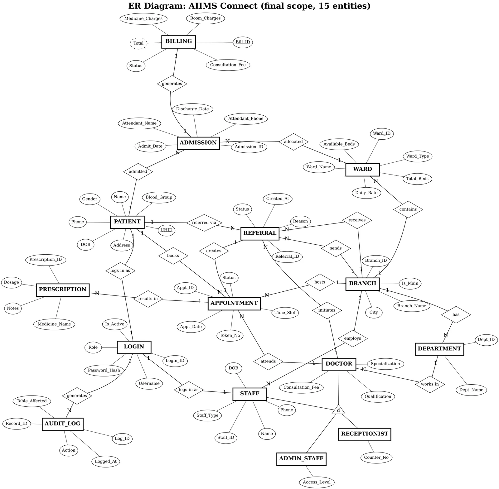

<div align="center">
  <h1>AIIMS Connect</h1>
  <p><strong>One Patient. One ID. Every Branch.</strong></p>
  <p>An academic multi-branch hospital management system built around a chain-wide patient identity and branch-specific care records.</p>
</div>

> **Academic prototype notice:** AIIMS Connect is an independent student project. It is not affiliated with, endorsed by, or an official system of AIIMS or the Government of India. It is not certified or validated for clinical use. Use synthetic demonstration data only; never enter real patient information.

## Project overview

AIIMS Connect models a hospital network in which a patient registers once and receives a unique Health Identifier (UHID) that remains valid across branches. Appointments, admissions, prescriptions, referrals and bills are recorded against the relevant branch, while authorised management roles can view network-level information.

The central database is MySQL. A Flask web application provides role-aware pages for patient services, OPD scheduling, inpatient admissions, ward capacity, inter-branch referrals, prescriptions, billing and reporting.

### FHIR-first clinical data

The imported Synthea FHIR R4 dataset is the primary source of synthetic clinical histories for the interoperability demonstration. Patient demographics and clinical resources stay in the dedicated `fhir_resource` store and are explored through the staff-only FHIR API. They are not copied into the operational AIIMS UHID registry or exposed through the patient portal. The operational tables remain available for hospital configuration, staff access, new patient registration and appointment workflows; they are not pre-populated with fake patient/clinical demo rows.

### The problem this project addresses

A patient may visit more than one campus over time. The system therefore needs to preserve one patient identity across the network without losing the branch context of each care event. It must also prevent conflicting actions such as booking the same doctor's active time slot twice or assigning more patients than a ward can accommodate. Multi-step actions such as admission, discharge and referral acceptance need consistent database updates.

### Project objectives

- Maintain one chain-wide patient registry and a unique UHID per patient.
- Keep appointments, admissions, prescriptions, referrals and bills associated with their relevant branch.
- Provide role-appropriate access for network administrators, branch administrators, doctors, receptionists and patients.
- Coordinate OPD booking, bed capacity and inter-branch referrals through database-backed workflows.
- Use relational constraints, transactions, views, stored procedures and triggers to keep records consistent.
- Provide branch-level and network-level summaries for occupancy and operational activity.

## Main modules

| Module | What it does |
| --- | --- |
| Authentication and workspace | Sign-in against the hospital database and role-aware workspace navigation. |
| Patient registry | Register a patient once, generate a UHID, and search/view patient records. |
| Branch and department context | Keep staff, wards, doctors and care records connected to their branch. |
| OPD appointments | Book and manage appointments with doctor, branch, date, time-slot and token rules. |
| Admissions and wards | Admit patients to wards, maintain available-bed counts and record discharge. |
| Referrals | Refer a patient from one branch to another and track the referral through acceptance or rejection. Acceptance creates an appointment at the receiving branch. |
| Prescriptions | Record medicine, dosage and notes against an appointment. |
| Billing and payments | Generate a bill at discharge, calculate charges and update payment status. |
| Reports | Display branch occupancy, revenue and network-level summaries from database views. |
| Audit records | Maintain records of selected sensitive database actions. |

The original synopsis describes a wider operational model, including a dedicated nurse role and blood-bank inventory. Those are part of the case-study scope, but are **not presented here as completed workflows in the current web application**.

## Database design

The current schema is organised around 15 entities:

`BRANCH`, `DEPARTMENT`, `WARD`, `LOGIN`, `STAFF`, `DOCTOR`, `RECEPTIONIST`, `ADMIN_STAFF`, `PATIENT`, `APPOINTMENT`, `PRESCRIPTION`, `ADMISSION`, `BILLING`, `REFERRAL` and `AUDIT_LOG`.

Key design decisions:

- **Chain-wide identity:** `PATIENT.UHID` identifies a patient across branches.
- **Branch-aware activity:** appointments, admissions and referrals retain branch context; billing is tied to an admission.
- **Staff specialisation:** `STAFF` is specialised into doctor, receptionist and admin-staff records.
- **Ward capacity:** `WARD.Available_Beds` is maintained by database triggers when admissions are created or discharged.
- **Referral flow:** a referral stores source and destination branches; accepting it creates an appointment for the receiving branch.
- **Derived values:** generated/trigger-maintained values reduce the chance of inconsistent manually maintained totals or counts.

### Entity-relationship diagram

The ER diagram below represents the 15-table operational schema. Two additional FHIR integration tables store imported resources and import metadata separately.

<div align="center">
  
  <br><br>
</div>

### DBMS objects

| Database object | Count | Purpose |
| --- | ---: | --- |
| Tables | 17 | 15 operational tables plus 2 isolated FHIR import/resource tables. |
| Views | 7 | Role-oriented data and aggregated patient-history, ward, occupancy, referral and revenue information. |
| Stored procedures | 11 | Encapsulate database workflows such as booking, admission, discharge, billing and referral transitions. |
| Triggers | 14 | Enforce or maintain selected data rules, including bed-capacity updates and audit entries. |

The seven views in the current schema are `branch_revenue_view`, `branch_ward_view`, `chain_occupancy_view`, `doctor_schedule_view`, `patient_history_view`, `patient_self_view` and `referral_flow_view`.

### DBMS concepts demonstrated

| Concept | How it is used in the project |
| --- | --- |
| Relational modelling | Primary keys, foreign keys and branch-aware relationships connect the network data. |
| EER specialisation | The operational schema models Staff subtypes as Doctor, Receptionist and Admin Staff. The Patient OPD/IPD subtypes from the original synopsis are not part of the implemented 15-table operational schema. |
| Normalisation | The schema separates patient, staff, login, branch and care-event data to reduce duplication. |
| Transactions | Multi-step operations are grouped so related changes can commit or roll back together. |
| Concurrency control | Database locking and uniqueness rules protect shared resources such as doctor time slots and ward capacity. |
| Constraints and indexes | Key, check and uniqueness rules protect records and support common searches. |
| Views | Provide reusable patient, schedule, ward, occupancy, referral and revenue summaries. |
| Stored procedures and triggers | Keep important workflow and record-maintenance logic close to the data. |
| Security | Passwords are verified with bcrypt, Flask routes enforce role and branch checks, and triggers record selected sensitive changes in `AUDIT_LOG`. This is academic access control, not a production security certification. |
| SQL operations | The project uses DDL and DML, joins, aggregate queries, constraints, indexes and transactional procedures with `COMMIT`/`ROLLBACK`. Application access is enforced through Flask role checks and scoped queries; a separate MySQL `GRANT`/`REVOKE` role layer is not claimed. |

## Technology stack

| Layer | Technology |
| --- | --- |
| Backend | Python 3.12, Flask 3.x, Jinja templates |
| Database | MySQL Community Server 8.4 |
| Database connector | `mysql-connector-python` 9.x |
| Frontend | HTML5, CSS3 and JavaScript |
| Password hashing | `bcrypt` |
| Configuration | `python-dotenv` |
| Production server | Gunicorn |
| Database administration | MySQL Workbench |
| Version control | Git and GitHub |
| Hosting | Railway |

## User roles

| Role | Scope |
| --- | --- |
| Chain administrator | Network-wide overview and consolidated branch reporting. |
| Branch administrator | Administrative operations and records for the assigned branch. |
| Doctor | Assigned OPD schedule, prescriptions and inter-branch referrals. |
| Receptionist | Patient registration, appointment coordination and related branch workflows. |
| Patient | Own profile and available care-history, prescription, admission and billing information. |

The synopsis also identifies nursing staff as an operational stakeholder. The current sign-in implementation documents the roles above; it does not claim a separate nurse workspace.

## Repository structure

```text
aiims-connect/
├── app/
│   ├── __init__.py
│   ├── db.py
│   ├── routes.py
│   └── fhir.py
├── scripts/
│   ├── clean_demo_data.py
│   ├── import_fhir.py
│   ├── init_db.py
│   ├── prepare_railway_schema.py
│   └── seed_demo.py (disabled)
├── sql/
│   ├── README.md
│   ├── schema.sql
│   └── migrations/
├── static/
│   ├── app.js
│   └── style.css
├── templates/
│   └── fhir_explorer.html
├── tests/
├── .env.example
├── Procfile
├── requirements.txt
├── runtime.txt
├── run.py
└── setup.bat
```

## Run locally (Windows)

### Prerequisites

- Python 3.12 (64-bit)
- MySQL Server 8.4 and MySQL Workbench
- Git

### 1. Clone the repository

```powershell
git clone https://github.com/bitmorphic/aiims-connect.git
cd aiims-connect
```

For an existing clone, use `git pull origin main`.

### 2. Create the environment and install dependencies

```powershell
py -3.12 -m venv .venv
.\.venv\Scripts\python.exe -m pip install --upgrade pip
.\.venv\Scripts\python.exe -m pip install -r requirements.txt
```

Or run `setup.bat`.

### 3. Configure environment variables

```powershell
Copy-Item .env.example .env
py -3.12 -c "import secrets; print(secrets.token_hex(32))"
notepad .env
```

Set the database host, port, database name and credentials for your local MySQL instance, and place the generated random value in `FLASK_SECRET_KEY`. Keep `.env` private and never commit it. Use a least-privilege MySQL account for application access; do not expose a local root account to the public web.

### 4. Create the schema (new database only)

In MySQL Workbench, create an empty database named `aiims_connect`, select it, and execute [`sql/schema.sql`](sql/schema.sql) once. The file contains database objects only; it does not insert demo or patient rows. **Never run it against an existing or populated database.**

### 5. Verify the database

```powershell
.\.venv\Scripts\python.exe scripts\init_db.py
```

This is a read-only schema check. It verifies the expected tables, views, procedures and triggers. It does not create, drop, seed or migrate database objects.

### 6. Preview legacy demo-data cleanup

The old synthetic data seeder is disabled. For an existing database, the cleanup utility identifies only patient accounts with the legacy `demo.patient.*` username pattern and linked staff created with a `Demo ` name. It removes their linked appointments, prescriptions, admissions, bills and referrals. It preserves branches, departments, wards, unrelated accounts, audit events (with demo actor references anonymised), and every FHIR resource. As a lockout safeguard, it also preserves all legacy Demo staff accounts and doctor-linked activity when no active non-demo administrator exists; provision and test a real administrator before removing those accounts.

First preview the exact candidates:

```powershell
.\.venv\Scripts\python.exe scripts\clean_demo_data.py
```

After reviewing the output and taking a restorable database backup, apply the cleanup explicitly:

```powershell
.\.venv\Scripts\python.exe scripts\clean_demo_data.py --apply --backup-confirmed --confirm "REMOVE ONLY LEGACY AIIMS CONNECT DEMO DATA"
```

This cleanup intentionally does not attempt to guess which unmarked rows are demo data. It does not delete records from the FHIR store. Never run it on a database containing real patient data without first reviewing the preview and backup.

### 7. Start the application

```powershell
.\.venv\Scripts\python.exe run.py
```

Open [http://127.0.0.1:5000](http://127.0.0.1:5000). Keep the terminal running while using the application. Sign in with an account provisioned in the database.

## Existing Railway database migrations

For an existing populated Railway database, take a backup and apply these migrations in MySQL Workbench before deploying the current branch:

1. [`2026_11_patient_appointment_approval.sql`](sql/migrations/2026_11_patient_appointment_approval.sql) widens the appointment status field and permits `Pending Approval` without rewriting existing appointment rows. Run once.
2. [`2026_11_fhir_interoperability.sql`](sql/migrations/2026_11_fhir_interoperability.sql) creates the original raw FHIR import and resource tables.
3. [`2026_11_fhir_relational_clinical.sql`](sql/migrations/2026_11_fhir_relational_clinical.sql) adds seven relational FHIR tables without altering the operational schema.

Select the Railway application database in Workbench before executing these files. Both FHIR migrations use `CREATE TABLE IF NOT EXISTS` and are safe to reapply. The migrations do not import the Synthea ZIP. After a restorable backup, run the legacy cleanup preview and (only after reviewing its candidate counts) the guarded cleanup command in the setup section. This removes only rows identifiable as belonging to the retired demo seeder; it does not alter the FHIR store.

## FHIR R4 interoperability

AIIMS Connect uses an isolated, read-only FHIR R4 store as the primary clinical-history dataset for the interoperability demonstration. The existing relational workflows remain available for hospital operations. This is an academic interoperability demonstration, not a complete or certified FHIR server.

### What is stored

The supplied Synthea ZIP contains 115 FHIR Bundles, 113 synthetic Patient resources and 130,703 resource entries across 24 resource types. The importer preserves each original FHIR resource as JSON in `fhir_resource`; `fhir_import_batch` records the source archive hash and import status. The additive relational projection creates `fhir_patient`, `fhir_encounter`, `fhir_observation`, `fhir_condition`, `fhir_procedure` and `fhir_medication_request`, plus `fhir_patient_link` for an optional verified UHID mapping. FHIR resource IDs remain distinct from AIIMS UHIDs, and patient-compartment indexes are derived from explicit Patient references inside Bundles.

The FHIR tables are separate from the operational `patient`, `appointment`, `prescription`, `admission` and `billing` tables. No automatic matching or merging of Synthea records with AIIMS UHIDs occurs. The sync preserves original FHIR names and does not insert or update operational patient rows. The legacy seeded operational demo records are no longer part of the intended baseline. New account registrations and appointment requests use the operational tables; synthetic historical clinical data remains in FHIR. Patient accounts cannot access this unlinked synthetic test dataset; authenticated hospital staff can use the API for demonstration and integration testing.

### Import the dataset

The ZIP is not stored in GitHub and is not loaded automatically during app startup. In this supplied archive, the ZIP is about 28.8 MiB and its uncompressed JSON Bundle files total about 385.5 MiB, before MySQL row/index overhead. Check available Railway database storage before importing the complete sample; MySQL row, JSON and index overhead will increase the on-disk footprint. After applying both FHIR SQL migrations and configuring the local `.env` to point to the intended MySQL database, run:

```powershell
.\.venv\Scripts\python.exe scripts\import_fhir.py "C:\path\to\synthea_sample_data_fhir_latest.zip" --dry-run
.\.venv\Scripts\python.exe scripts\import_fhir.py "C:\path\to\synthea_sample_data_fhir_latest.zip"
```

The dry run parses the archive and reports Bundle/resource totals without opening a database connection. The actual importer writes in small batches, tracks the SHA-256 of the ZIP, and skips an archive that has already completed successfully. It then automatically runs the relational sync. Use `--force` only when you intentionally need to reprocess the exact same ZIP. Both import and relational projection are idempotent: resources are upserted by FHIR type and logical ID. You can also rerun only the projection using `python scripts/sync_fhir_tables.py`.

For a Railway import from Windows, configure `.env` with the Railway MySQL **public TCP proxy** host and port plus the database username, password and database name from Railway. Do not use Railway's private hostname from a local PC. Keep these credentials in `.env`; never commit them. The ZIP contains synthetic US-based records and US Core profiles; it is a test dataset, not AIIMS patient data or an India-specific terminology pack.

### FHIR API

The CapabilityStatement is available at:

- `GET /fhir/metadata` — FHIR version and the API's declared read/search capabilities (no login required).
- `/fhir/explorer` — staff-only browser for synthetic patient demographics, resource counts and expandable clinical-resource JSON.
- `GET /fhir/Patient?_count=5` — search patients (hospital staff login required).
- `GET /fhir/Patient/{id}` — read a Patient resource by FHIR logical ID.
- `GET /fhir/Observation?patient={patient-fhir-id}&_count=20` — find that patient's observations.
- `GET /fhir/Condition?patient={patient-fhir-id}` and `GET /fhir/MedicationRequest?patient={patient-fhir-id}` — example patient-compartment searches.

Resource responses use `application/fhir+json`. Search responses are FHIR `Bundle` resources of type `searchset`; errors use `OperationOutcome`. Search supports the parameters declared by the CapabilityStatement: `_id`, `_count`, Patient `name`/`gender`/`birthdate`/`identifier`, and applicable `patient`/`code`/`status`/`clinical-status`/`verification-status` searches. Server-side paging uses `_offset` in the next link, and `_summary=count` returns only the total.

FHIR resource reads and searches require an authenticated staff account. The Patient portal is deliberately denied access to the synthetic records because they have no approved mapping to AIIMS UHIDs. This first iteration is read-only: it does not implement FHIR create/update/delete, transaction processing, terminology validation or full conformance testing. It demonstrates the FHIR R4 resource model and REST read/search interactions without claiming to be a production FHIR server.

## Railway deployment

The project is deployed as a Flask web service on Railway and uses a Railway MySQL service. The public demo address is:

**[Open the AIIMS Connect demo](https://web-production-d89a88e6.up.railway.app/)**

For a fresh Railway environment, configure the web service to use Railway's private MySQL variables (replace `MySQL` with the actual database service name):

```text
DB_HOST=${{MySQL.MYSQLHOST}}
DB_PORT=${{MySQL.MYSQLPORT}}
DB_USER=${{MySQL.MYSQLUSER}}
DB_PASSWORD=${{MySQL.MYSQLPASSWORD}}
DB_NAME=${{MySQL.MYSQLDATABASE}}
FLASK_SECRET_KEY=<a fresh random secret>
FLASK_DEBUG=0
COOKIE_SECURE=1
```

To bootstrap a **new, empty** Railway database:

1. Connect MySQL Workbench to the Railway MySQL TCP Proxy.
2. Select the empty target database (normally Railway's provisioned `railway` schema).
3. Execute [`sql/schema.sql`](sql/schema.sql) once. It has no hard-coded `USE` statement, no row inserts and no `DROP` statements.
4. Verify the schema using `scripts/init_db.py`, then deploy the Flask service.

The bootstrap creates database objects only; it does not migrate local rows or seed demo accounts. Never run it against a populated database. The public web service should use Railway's private network connection; Workbench can use the database TCP Proxy. The optional `scripts/prepare_railway_schema.py` can regenerate a bootstrap from a different structure-only MySQL dump. See [`sql/README.md`](sql/README.md) for the database deployment notes.

## Demonstration workflow

A typical end-to-end demonstration follows this sequence:

1. A patient creates their own account through the public Patient Portal. MySQL generates a chain-wide UHID and login together.
2. The patient signs in, selects a doctor, branch, date and OPD time slot, and submits an appointment request. The request remains **Pending Approval** and is visible in the hospital administration workspace.
3. A chain administrator or the relevant branch administrator reviews the request and approves it. The appointment becomes **Scheduled** only after approval.
4. The doctor completes the approved appointment and creates a prescription.
4. Admit the patient to an available ward and observe the available-bed count update.
5. Discharge the patient, generate the bill, and update its payment status.
6. Create a referral to another branch, accept it at the destination, and verify the appointment created for that branch.
7. Review branch occupancy and revenue in the reporting workspace.

The operational workflow is retained for new registrations and staff-managed care activity. After removing the legacy demo records, rehearse each workflow with newly created academic test accounts before presenting it; this repository change does not claim that the live Railway database has already been cleaned or revalidated.

### Tests

Run the repository smoke tests with:

```powershell
.\.venv\Scripts\python.exe -m unittest discover -s tests -v
```

The smoke tests do not replace integration testing against MySQL. Concurrency, rollback and access-boundary checks should be run against the target database before any formal demonstration.

## Limitations and responsible use

- This is a DBMS academic prototype, not a production hospital information system.
- It has not undergone clinical validation, formal security assessment, regulatory review or production-scale load testing.
- Do not enter actual patient names, contact details, UHIDs, diagnoses, prescriptions, medical histories or payment information.
- Features in the original case-study scope that are not implemented in the current web application should be treated as future work, not as available functions. This includes the Nurse role, blood-bank workflows, branch/department/staff administration screens and Patient OPD/IPD subtype tables.
- The current login flow does not implement the synopsis' failed-login account lockout. The Flask permanent session lifetime is configured for 45 minutes (not the proposed 15 minutes), and current forms do not include CSRF tokens. Do not treat the prototype as ready for production or real patient use.
- The Railway demo may be unavailable or reset as hosting and demonstration data change.

## Project team

**Institution:** National Institute of Technology Delhi (NIT Delhi)  
**Department:** Computer Science and Engineering  
**Programme:** B.Tech. (CSE), 3rd Semester  
**Project code:** CSBB 204  
**Supervisor:** Dr. Shelly Sachdeva

| Student | Roll number |
| --- | --- |
| Lakshay Beniwal | 251210058 |
| Mohammad Anas | 251210067 |
| Mohammad Tabish Irfan | 251210068 |

## References

- AIIMS Online Registration System (ORS): [ors.gov.in](https://ors.gov.in/)
- All India Institute of Medical Sciences: [aiims.edu](https://www.aiims.edu/)
- Project synopsis prepared for CSBB 204, Department of Computer Science and Engineering, NIT Delhi.
- ER diagram prepared for the current AIIMS Connect schema.
- Synthea synthetic healthcare data and sample downloads: [Synthea downloads](https://synthetichealth.github.io/downloads.html) and [Synthea project](https://github.com/synthetichealth/synthea).
- HL7 FHIR R4 specification: [HTTP RESTful API](https://www.hl7.org/fhir/R4/http.html) and [Bundle resource](https://www.hl7.org/fhir/R4/bundle.html).
