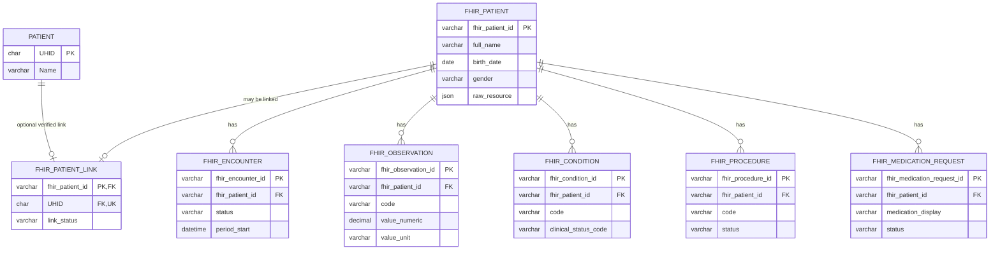

# FHIR relational extension

The integrated ER diagram at `docs/AIIMS_Connect_Integrated_ER_Diagram.png` shows the complete operational and FHIR data model. FHIR is the standardized clinical-history layer; operational hospital transactions remain in their existing entities.

## Safeguards

- FHIR logical IDs and AIIMS UHIDs remain distinct.
- `fhir_patient_link` is the only bridge to `patient.UHID`. It starts unlinked;
  linking must be a verified/manual action. The sync never matches patients by name.
- FHIR Encounters are historical clinical visits, not appointment slots.
- FHIR MedicationRequests are source medication orders, not local prescription transactions.
- The selected relational rows keep their original JSON payload. All other imported
  FHIR resource types remain available in the lossless `fhir_resource` archive.
- Sync is repeatable: each projection is upserted by its FHIR resource logical ID.

## Unified patient clinical timeline

The staff patient registry and patient portal open `/clinical/patients/<UHID>/history`. This view combines appointments, admissions, prescriptions, referrals and bills from the operational schema with linked FHIR Encounters, Observations, Conditions, Procedures and MedicationRequests. The FHIR identity link is manually verified, one-to-one and reversible. Doctors can view only patients with an existing appointment assignment; patient users can view only their own UHID. FHIR source rows remain read-only in this workflow.
